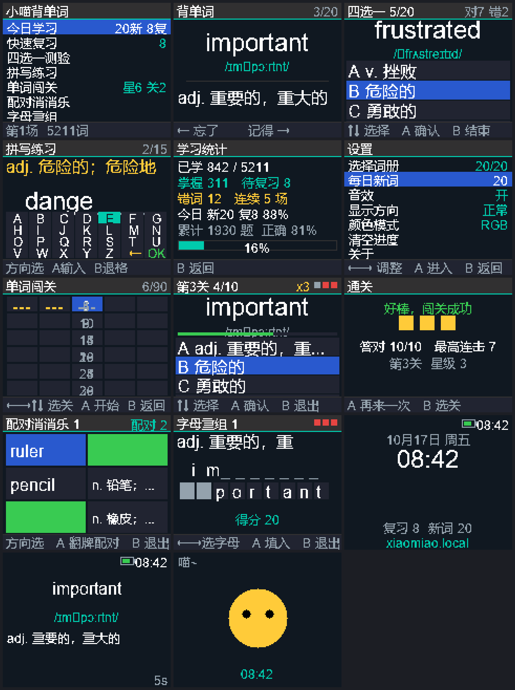

# 小喵掌机 · 背单词固件

给学而思小喵掌机（ESP32 + ST7735 160×128 + 6 键 + 无源蜂鸣器 + WiFi）写的独立背单词固件。
内置人教版 PEP **小学三年级起点 → 高中选择性必修** 共 20 册、**5211 个去重单词**（英文 / 音标 / 中文释义），
全部烧进 Flash，**不依赖 TF 卡**。



> 功能一览：**大字号专注界面**（英文 24px / 中文释义 16px）、**三种单词游戏**（单词闯关 30 关 + 配对消消乐 + 字母重组）、
> **WiFi 联网**（NTP 对时 + 网页词库管理）、**8 种可配置屏保**、**状态栏常显时间与电量**、
> **SM-2 记忆调度**，自检 **25/25 通过**（COM3 实机验证，22 屏渲染 156ms）。

---

## 一、硬件与引脚

与社区 Retro-Go 移植完全一致，本机 COM3 实测通过（ESP32-D0WD，4MB Flash，**PSRAM 4088KB 可用**）。

| 功能 | GPIO |
|---|---|
| 上 / 下 / 左 / 右 | 2 / 13 / 27 / 35 |
| A / B | 34 / 12 |
| 屏幕 CS / DC / MOSI / CLK / MISO | 5 / 4 / 23 / 18 / 19 |
| TF 卡 CS（保持高电平离线） | 22 |
| 无源蜂鸣器 | 14 |

屏幕无硬件复位脚、无背光控制，走软件复位；MADCTL 默认 `0x60`（与 Retro-Go 一致）。

## 二、按键操作

| 键 | 作用 |
|---|---|
| ↑ ↓ | 移动光标 / 上下翻 |
| ← → | 左右翻页、调整数值 |
| A | 确认 / 显示释义 / 输入 |
| B | 返回上一级 / 拼写界面退格 |

- **背单词卡片**：A 显示释义 → `←` 判「忘了」、`→` 或 `A` 判「记得」
- **四选一**：↑↓ 选项，A 确认
- **拼写**：方向键在字母盘上移动，A 输入，`←` 退格，`OK` 提交
- **单词闯关**（主菜单第 5 项）：见下文「单词闯关玩法」
- **配对消消乐**（主菜单第 6 项）：方向键选牌，A 翻牌配对；英文牌与中文释义牌配成一对即消除
- **字母重组**（主菜单第 7 项）：`←→` 选打乱字母，A 填入，按正确顺序还原单词
- **错词本**：A 从选中词开始重练；第一项「清空错词本」按两次 A 生效
- **屏保中按任意键** → 立即回到之前的界面


## 二点五、单词闯关玩法

每天刷关练单词的闯关模式，进度存在设备里（NVS，断电不丢）：

| 规则 | 说明 |
|---|---|
| 关卡 | 共 **30 关**，每关 **10 题**；通关才解锁下一关（第 1 关默认开放） |
| 题型 | 每关三种题型轮换：**英→中**、**中→英**、**音标→英**，全部四选一 |
| 限时 | 每题 **15 秒**，倒计时条变红（剩 5 秒）提示；超时算错 |
| 生命 | **3 条命**（右上角红方块），答错/超时扣 1，扣完挑战结束 |
| 连击 | 连对 2 题起显示「连击 xN」，激励连续答对 |
| 过关 | 答对 **≥8 题** 通关；**星级 = 答对数 − 7**（8/9/10 题 = 1/2/3 星） |
| 词源 | 优先从**已学词**出题，已学词不足自动用启用词册补齐 |
| 调度 | 答题结果**计入 SM-2 记忆调度**——闯关刷题同时推进复习计划，错词自动进错词本 |
| 结算 | 显示星星（■■■）、答对数、最高连击；A 再来一次，B 回选关 |

选关界面：5×6 网格，每格显示关号 + 3 格星级条，未解锁关卡灰显；`←→` 翻页选关。

## 二点六、配对消消乐 & 字母重组

### 配对消消乐（英↔中记忆配对）

每关 6 张牌（3 张英文 + 3 张对应中文释义）随机摆放，`←→↑↓` 移动光标、A 翻牌：

- 翻开两张：同一单词的英文牌 + 中文牌 → **配对成功消除**（绿色），计入 SM-2 答对
- 配错自动翻开复位，计入答错并进错词本
- 6 张全部消除进入下一关，配对数/尝试次数实时统计

### 字母重组（拼写还原）

显示中文释义和打乱的字母格子，`←→` 选择字母、A 填入：

- 按**原单词字母顺序**填满即判定（填错整词作废，扣 1 条命并重新打乱）
- **3 条命**，连续答对 8 个词通关；每词 +10 分
- 答题结果同样计入 SM-2 调度

两个游戏共用词库（5211 词），与闯关一样在玩的同时推进复习计划。

## 三、功能

1. **今日学习** — 到期复习词（打乱）+ 每日新词（默认 20，可调 10/15/20/30/50）
2. **快速复习** — 只跑到期队列
3. **四选一测验** — 20 题，错词优先出题，答错自动进错词本
4. **拼写练习** — 15 题，看中文拼单词，只挑纯字母词
5. **错词本** — 自动收集、单独重练、一键清空
6. **统计** — 已学/掌握/待复习/错词/连续场次/今日与累计正确率 + 进度条
7. **WiFi** — 扫描并连接、断开、忘记网络、立即对时、手动改时、查看网址
8. **设置** — 选册、每日新词、音效、显示方向、颜色模式、**屏保样式**、**屏保延时**、**电量显示模式**、清空进度

复习调度用简化 **SM-2**：答对 `1→3→×难度系数` 递增（上限 3650 天），答错降难度系数并放回明天，
连续答对 3 次自动移出错词本。

## 四、WiFi 与对时

开机后台自动连接已保存的 WiFi（不阻塞开机），连上后：

| 方式 | 说明 |
|---|---|
| **NTP 自动对时** | 阿里云 / 国家授时中心 / pool.ntp.org，连网即校准 |
| **浏览器访问** `http://xiaomiao.local` | 状态查看、手动改时、**上传 CSV 词库**、**从网址拉取词库**、进度备份/恢复、改 WiFi |

- 没有网络也能用：可在「设置 → 时间设置」手动调时间，进度按日期正常调度
- 时间会定期写入 NVS，掉电重启后时间大致连续
- 词库 CSV 格式：`英文,音标,中文`（音标可留空）

## 五、屏保（8 种，可在设置里选）

数字时钟（**默认**）/ 模拟表盘 / 星空穿越 / 飘雪 / 弹跳方块 / 水波 / 单词轮播 / 猫咪

- 空闲 60 秒自动进入（可调：关闭 / 15s / 30s / 60s / 2min / 5min）
- **所有屏保都显示时间**，多数同时显示电量与待复习词数
- 按任意键退出屏保回到原界面

## 六、状态栏

所有界面的标题栏右侧常驻：**电量图标（颜色随电量变化）+ 当前时间 HH:MM**。
未对时时显示 `--:--` 并以高亮色提示。

### 关于电量

掌机**没有电池电压检测电路**，默认走「估算」模式（按使用时长推算，满电约 10 小时）。
可在设置里改为：

- **扩展口**：外接分压电阻到 ADC 脚（默认 GPIO32，可改 32/33/25/26），按电压换算百分比
- **隐藏**：不显示电量
- 设置里可在「标记满电」后归零估算计数

## 七、构建

```bash
# 1. 生成词库与字模（改了 src 里的中文后要重跑）
python tools/pack_words.py

# 2. 编译
pio run

# 3. 刷入（COM3）
python tools/flash.py COM3

# 4. 串口自检（115200）
python tools/serialtest.py COM3 --script=p:1,i:2,t:25,e:8,i:2
```

- `tools/flash.py` 会把 bootloader / 分区表 / app 合并成一个 `firmware.bin`（偏移 0x0）一次性写入
- `tools/serialtest.py` 会自动压低 DTR/RTS 避免设备复位，并持续排空串口输出
- 串口命令（115200）：
  `t`=自检　`e`=屏保自检　`i`=信息　`s`=保存　`w`=WiFi　`W`=扫热点　`n`=对时
  `T<unix>`=授时　`p`=屏号　`k<掩码>`=模拟按键　`z<n>`=按键压测　`r`=重启

### 自检结果（实机 COM3，2026-10-17）

```
===== 小喵背单词 自检 =====
  DRAM 空闲 4259871  最低水位 4257927   PSRAM 空闲 4065691
  词库 5211（自定义 0） 空英文=0 空释义=0
  词册 21 组合计 5211
  字体抽样缺字 0 处
  界面文案缺字 0 处
  15 屏渲染耗时 119 ms
  屏保 8 种 x3 帧耗时 106 ms
  电量 100%（模式 估算）
===== 自检完成：通过 25 失败 0 用时 449 ms =====
```

另有实测：
- WiFi 扫描发现热点（射频硬件正常）
- 授时 `T<unix>` 后 `synced=1`，时间正确走动
- 3000 次随机按键压测无崩溃，堆稳定在 4.26 MB
- 逐屏渲染 15 屏 119 ms，8 种屏保 3 帧 106 ms

## 八、目录结构

```
xiaomiao-vocab/
  platformio.ini      构建配置（board=esp32dev, Arduino 框架, 自定义分区表, PSRAM）
  partitions.csv      4MB 分区：nvs + phy + app 3.875MB + prog(LittleFS) 256KB
  data/               人教版 PEP 词库 JSON（20 册）
  tools/pack_words.py 词库清洗 + 精简中文字模生成
  tools/flash.py      合并 bin + esptool 刷机
  tools/serialtest.py 串口自检 / 命令工具
  tools/preview.py    PC 端 1:1 界面预览图
  preview/preview.png 界面预览（含屏保）
  src/
    config.h          引脚与配色
    hal.h/.cpp        ST7735 驱动 + UTF-8 文本渲染 + 按键 + 蜂鸣器 + PSRAM 帧缓冲
    store.h/.cpp      NVS 配置 + LittleFS 进度 + SM-2 调度
    words.h/.cpp      词表访问 + 自定义词 + CSV 导入导出
    clock.h/.cpp      时间（NTP / 手动 / 掉电续走）
    net.h/.cpp        WiFi + mDNS + Web 管理页 + 远端词库
    power.h/.cpp      电量估算 / 扩展口 ADC / 隐藏
    saver.h/.cpp      8 种屏保
    status.h/.cpp     状态栏（电量 + 时钟）
    app.h/.cpp        全部界面与交互
    main.cpp          入口 + 串口命令
    words_data.cpp    自动生成的词表
    font_data.cpp     自动生成的点阵字模（2874 个字符，双字体混排）
```

## 九、已知限制

- 屏幕只有 160×128：中文释义已裁剪到 15 字内，长释义会自动换行/截断
- 只有无源蜂鸣器，**没有真人发音**（要发音需硬件加 I2S 功放+喇叭）
- 电量是**估算**（硬件无检测电路），要精确请接分压电阻到扩展口 ADC
- 刷了这个固件，掌机上原来的 MicroPython / 学而思课程环境就没了（原厂备份另存，可随时刷回）

## 十、词库来源

`cyforkk/pep-english-words`（人教版 PEP 点读词库，数据源 `lilinji/English`），MIT 协议。
脚本做了去重（跨册重复保留最低年级一次）和释义精简（去掉词典式的多余义项与方括号标注）。
